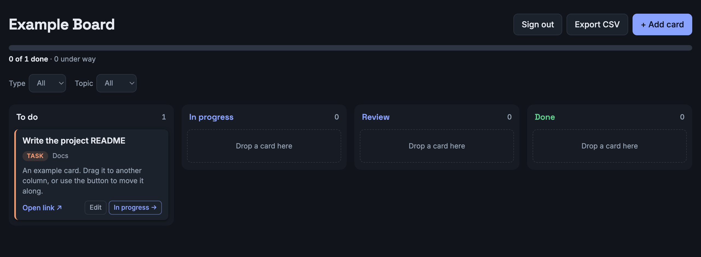

# Board

A small, self-hosted, Trello-style board. It is one HTML file with no build step. Your cards live in your own free [Supabase](https://supabase.com) project, so the board stays in sync across your devices.



## What it does

- Columns you can rename or change (To do / In progress / Review / Done by default).
- Cards with a title, type, topic, link and notes.
- Drag and drop between columns, including on touch screens, plus a button on each card to move it one column along.
- Filters by type and topic, and a progress bar.
- Sign-in with email and password. Each user sees only their own cards.
- Live updates: a change on one device appears on the others within a second or so.
- Export to CSV.

It does not work offline, and boards are per user: there are no shared boards.

## Files

| File | Purpose |
| --- | --- |
| `index.html` | The whole app. |
| `config.example.js` | Template for your settings. Copy it to `config.js`. |
| `setup.sql` | Creates the database table and its access rules. |

## Setup

You need a Supabase account (the free plan is enough). Dashboard labels change from time to time, so a setting may sit under a slightly different name.

1. **Create a Supabase project** at [supabase.com](https://supabase.com).
2. **Create your user.** In the dashboard, go to Authentication > Users > Add user. Enter an email and password and tick "Auto Confirm User".
3. **Turn off public sign-ups** unless you want other people to create accounts: Authentication > Sign In / Providers > disable "Allow new users to sign up". If you leave sign-ups on, each new user gets their own private, empty board.
4. **Create the table.** Open SQL Editor > New query, paste in the contents of `setup.sql` and run it.
5. **Add your settings.** Copy `config.example.js` to `config.js`. From Project Settings > API, paste in:
   - the project URL, for example `https://abcdefgh.supabase.co`
   - the publishable key (older projects call it the anon key)
6. **Run it locally.** From this folder:

   ```sh
   python3 -m http.server
   ```

   Open <http://localhost:8000> and sign in with the user from step 2.

## Settings

Everything is in `config.js`:

| Setting | What it does |
| --- | --- |
| `supabaseUrl` | Your Supabase project URL. |
| `supabaseKey` | Your publishable (anon) key. |
| `title`, `subtitle` | Text at the top of the page. The title also names the browser tab. |
| `columns` | The columns, left to right, each with an `id` and a `name`. The first is "not started" and the last is "done". |
| `types` | The card types offered when you add a card. The first seven each get their own colour. |

Renaming a column is safe. Changing a column's `id` is not: cards store the id, so cards in a column whose id disappears show up in the first column until you move them.

## Hosting

The app is static files, so any static host works. It must be served over `https` (or from `localhost`) for sign-in to be dependable and for the board to be installable as an app.

- **Cloudflare Pages:** in the dashboard, go to Workers & Pages, create a Pages project and upload this folder. To update later, upload again or run `npx wrangler pages deploy .` from the folder.
- **Netlify:** drag the folder onto [Netlify Drop](https://app.netlify.com/drop).
- **GitHub Pages:** this deploys from the repository, so `config.js` has to be committed. Remove the `config.js` line from `.gitignore`, commit it, and enable Pages in the repository settings. See the note on keys below.

Once it is hosted you can install it like an app: "Add to Dock" in Safari or "Install" in Chrome on a computer, and "Add to Home Screen" on a phone.

## Security

- **The publishable key is meant to be public.** It only identifies your project. What protects your cards is row-level security, which `setup.sql` turns on: a signed-in user can read and change only the rows they own.
- **Never use the secret or `service_role` key** in `config.js`. That key bypasses row-level security.
- **Turn off sign-ups** if the board is only for you (step 3). With sign-ups on, strangers can create accounts in your project, although they still cannot see your cards.
- **Committing `config.js`** publishes your project URL and publishable key. That is safe as long as row-level security is on, and it is how GitHub Pages hosting works.

## How it works

- `index.html` loads [supabase-js](https://github.com/supabase/supabase-js) and [SortableJS](https://github.com/SortableJS/Sortable) from public CDNs, pinned to fixed versions. There is no server code of its own.
- Cards are rows in one `cards` table. A card's column is its `status`, and its position within the column is `sort_order`. Moving a card writes only that one row.
- The page subscribes to changes on the table and reloads the cards when one arrives, and again whenever you return to the tab.

## Licence

[MIT](LICENSE)
