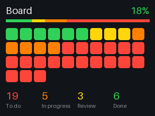

# Board on a Raspberry Pi screen

An optional extra: show your board's progress on a
[Pimoroni Display HAT Mini](https://shop.pimoroni.com/products/display-hat-mini)
(a 320x240 LCD that plugs onto the Pi's 40-pin header). One square per card,
coloured by column, from red (not started) to green (done).



## Setup

On the Pi (Raspberry Pi OS Lite, 64-bit):

```sh
sudo raspi-config nonint do_spi 0        # turn on SPI, which the screen uses
# The screen reuses SPI's MISO pin (GPIO 9), so tell SPI to leave it alone.
echo "dtoverlay=spi0-2cs,no_miso" | sudo tee -a /boot/firmware/config.txt
sudo reboot
```

Then, after it restarts:

```sh
sudo apt update
sudo apt install -y python3-venv python3-pil python3-numpy python3-spidev
```

Copy this `pi` folder to `~/board/pi` on the Pi, then:

```sh
cd ~/board/pi
python3 -m venv --system-site-packages .venv
.venv/bin/pip install st7789
cp board.env.example board.env
chmod 600 board.env
nano board.env                           # fill in your Supabase details and login
.venv/bin/python board_display.py        # the screen should light up; Ctrl+C to stop
```

To start it at boot:

```sh
sudo cp board-display.service /etc/systemd/system/
sudo systemctl enable --now board-display
journalctl -u board-display -f           # watch its log
```

The service file assumes the user `rpi` and the folder `/home/rpi/board/pi`.
Edit it if yours differ.

## Notes

- The script signs in as your board user, so `board.env` holds that password.
  Keep the file private (`chmod 600`) and out of git.
- It checks for changes every 60 seconds (`BOARD_POLL_SECONDS`).
- A small red dot in the corner means the last check failed, for example
  because the Wi-Fi dropped. The picture stays up and it keeps trying.
- To try the layout without a Pi:
  `python board_display.py --demo --preview out.png` (needs Pillow).
